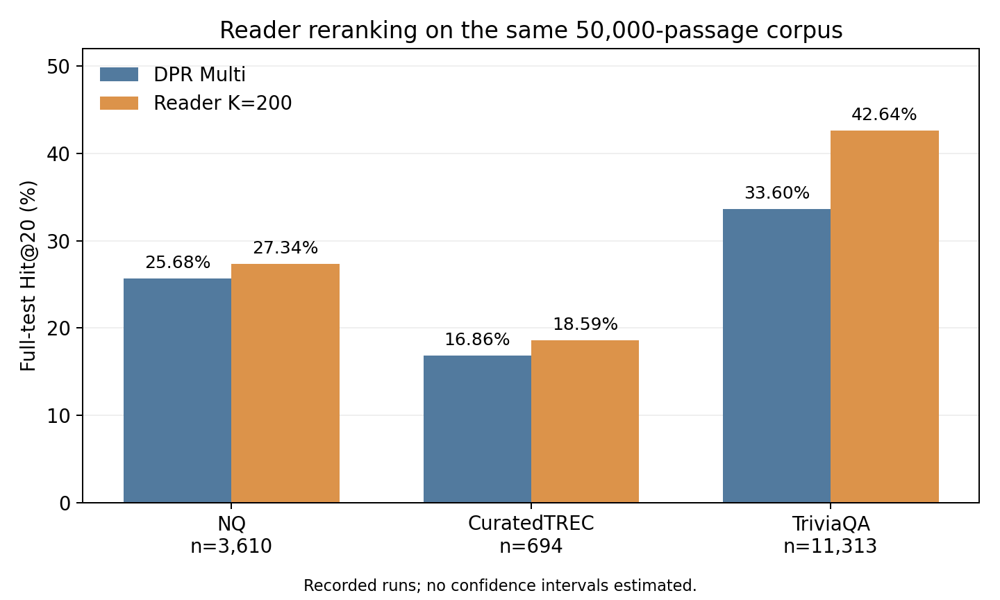
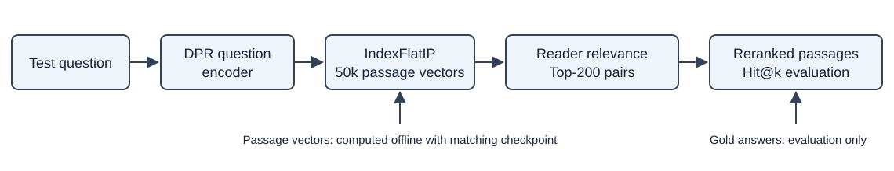

# DPR 50K: Group 5 reproduction and Reader reranking

Code, saved results, notebooks, images, paper and downloadable weights for
an empirical study on a fixed 50,000-passage Wikipedia corpus.

Authors: Hồ Thành Tài; Lê Trần Bình An; Phan Ba Song Toàn;
Tran Quang Long; Trịnh Minh Bảo Trân.
Department of Artificial Intelligence, FPT University, Da Nang, Vietnam.

The project reuses official DPR retriever and Reader checkpoints. Improvements
are measured against our DPR-only baseline on the same 50k corpus, not new
training, a novel Reader architecture, or original full-corpus paper scores.

## Full-test Hit@20

| Dataset | Questions | DPR Multi | Reader K=200 | Gain (percentage points) |
|---|---:|---:|---:|---:|
| NQ | 3,610 | 25.68% | 27.34% | +1.66 |
| CuratedTREC | 694 | 16.86% | 18.59% | +1.73 |
| TriviaQA | 11,313 | 33.60% | 42.64% | +9.04 |

## Submission contents

| Requirement | Location |
|---|---|
| Original DPR architecture and entry points | dpr/, conf/, root Python files |
| Group sampling, evaluation and reranking code | scripts/ |
| Saved metrics, provenance and arithmetic checks | results/ |
| Recorded Kaggle execution logs | results/logs/ |
| Notebooks | notebooks/ |
| Images | images/ |
| Six-page IEEE-format paper | paper/group5-dpr-paper.pdf |
| Actual weights, vectors and fixed data | [Artifacts release](https://github.com/ThieuEmAnhKhongSongDuoc/dpr-50k-reader-reranking/releases/tag/artifacts-v1) |
| Resource IDs, sizes and SHA256 | weights/manifest.json |

## Quick check

    python scripts/validate_results.py

This requires no GPU and does not execute a model. See docs/REPRODUCE.md
for asset downloads and inference commands. Saved results are previous
completed experiments, not new predictions from repository publication.

## Pipeline

Question -> official DPR question encoder -> exact FAISS IndexFlatIP ->
Top-200 -> official Reader relevance head -> ranked passages.
Gold answer strings enter evaluation only.

The main runs used two Kaggle T4 GPUs, candidate batch 16, query batch 8,
retriever length 256 and Reader length 350. Baselines cover 28,219 questions;
reranking covers 15,617. Overall corpus coverage is 64.29%.

Read docs/SCOPE.md, docs/ENVIRONMENT.md and docs/UPSTREAM.md for limitations.
Full TriviaQA K=100 and a paired HNSW/FlatIP ablation are not claimed.
Invalid historical score-fusion results are excluded.
Upstream reference commit: a31212dc0a54dfa85d8bfa01e1669f149ac832b7.
See UPSTREAM_README.md, THIRD_PARTY_NOTICES.md and LICENSE.
